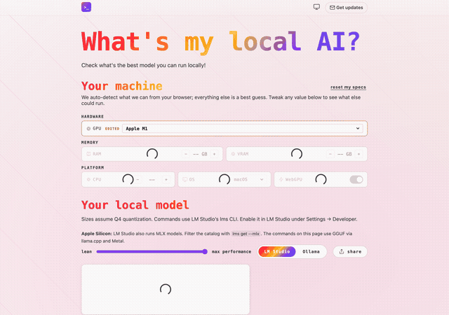

# whatsmylocalai

[](../LICENSE)

Which local model can your machine actually run? This page answers that, and
shows how far off the models that do not fit are.

Detects your hardware in the browser and recommends models to run with
[Ollama](https://ollama.com) or [LM Studio](https://lmstudio.ai). Everything
runs client-side; nothing leaves the browser.

<picture>
  <source media="(prefers-color-scheme: dark)" srcset="docs/assets/demo-dark.gif">
  
</picture>

## Try it

[whatsmylocal.ai](https://whatsmylocal.ai)

## What you get

- The best model that fits your GPU or Mac, with the command to run it.
- The gap, in gigabytes, for every model that does not fit.
- An estimated tokens-per-second band for each model that fits.
- A lean-to-performance slider, so a small model can win over a large one that
  barely fits.
- A simulated machine: change GPU, RAM, VRAM, or OS and the picks update.

No account and no upload: detection never leaves the browser.

## Run it locally

```bash
npm install
npm run dev     # http://localhost:8080
npm run build   # production build in _site/
```

## How it works

GPU name via WebGL, RAM via `navigator.deviceMemory` (Chromium caps it at 8 GB),
CPU cores via `navigator.hardwareConcurrency`, OS from the user agent. That
becomes a VRAM estimate, and the page picks from a Q4 model catalog built at
build time.

The full path, including the Apple Silicon RAM cross-check and the ranking, is
in [how-it-works.md](docs/how-it-works.md).

## Docs

| Doc                                  | What it covers                                             |
| ------------------------------------ | ---------------------------------------------------------- |
| [How it works](docs/how-it-works.md) | Detection, RAM cross-check, VRAM estimate, ranking         |
| [Catalog](docs/catalog.md)           | Model sources, the weekly refresh, GPU and Apple bandwidth |
| [Development](docs/development.md)   | Commands, tests, CI, demo GIF and social card              |
| [Deploy](docs/deploy.md)             | Cloudflare Pages and the API URL                           |
| [Plan](docs/plan.md)                 | v2 work; the Product board wins if the two disagree        |

## License

MIT. See [LICENSE](../LICENSE).
